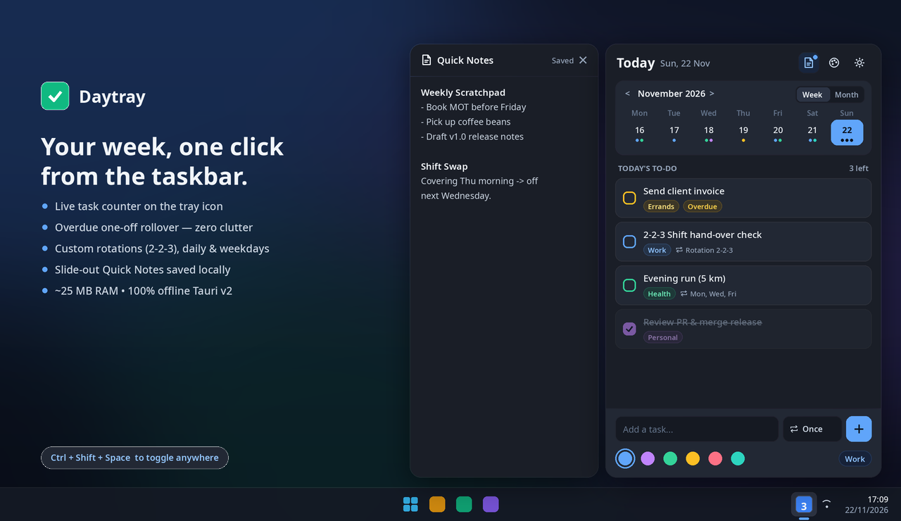
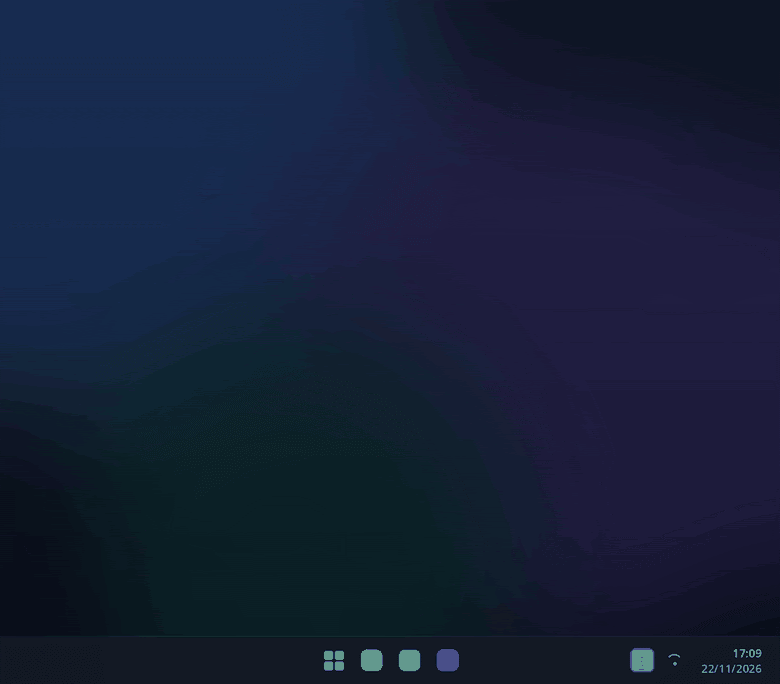
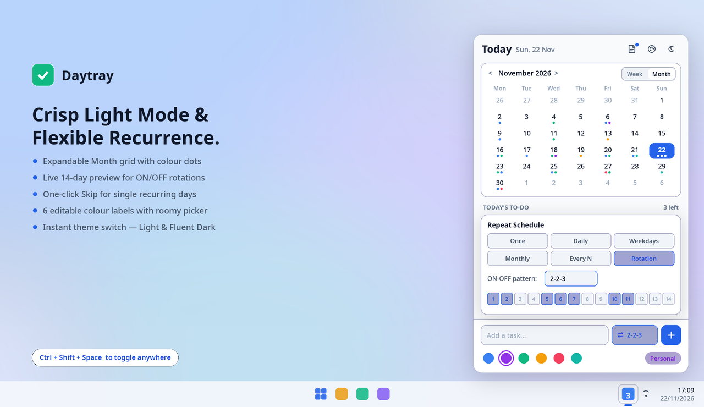

<div align="center">
  <h1>Daytray</h1>
  <p><strong>A minimal, offline-first Windows taskbar tray flyout for daily to-dos, recurring schedules, and quick notes.</strong></p>

  <p>
    <a href="https://github.com/Harriszed/daytray/releases/latest">
      
    </a>
    <a href="https://github.com/Harriszed/daytray/actions/workflows/ci.yml">
      
    </a>
    
    
    <a href="./LICENSE">
      
    </a>
  </p>

  <br />

  
</div>

---

## Why Daytray?

Most to-do apps are either bloated workspace tools or browser tabs you forget to open. **Daytray** sits quietly in your Windows system tray, opens instantly above the taskbar on click (or `Ctrl + Shift + Space`), and either dismisses when you click away or stays open in the corner whenever you toggle **Keep Open**.

- **Lightweight:** Built with Tauri v2 (~20–40 MB RAM, zero frontend framework overhead).
- **100% Local & Private:** Stores everything in a single plain JSON file on your PC. No accounts, no cloud sync, no telemetry.
- **Fast Entry:** Add a colour-coded or recurring task in under 3 seconds.

---

## Live Preview

<div align="center">
  
</div>

---

## Features

- **System Tray Flyout & Live Counter:** Shows your remaining task count for today right on the taskbar icon — and flips to a green checkmark when today is clear.
- **Keep Open Mode:** Click the **Pin** icon (or right-click the tray icon → **Keep Open**) to park Daytray cleanly in the bottom-right corner behind your active apps. Clicking the tray icon or pressing `Ctrl + Shift + Space` raises it back to the front whenever it's buried, and your choice persists across restarts.
- **Week Strip + Expandable Month Calendar:** Scan your week with colour-coded task dots or expand to the full month grid. Click any day to view or add tasks.
- **Smart Rollover:** Incomplete one-off tasks automatically carry forward to **Today** with an `Overdue` badge. Missed recurring tasks never pile up into duplicates.
- **Flexible Recurrence:** Daily, specific weekdays, monthly (with end-of-month clamping), every *N* days, and custom ON/OFF shift rotations (e.g. `2-2-3`) with a 14-day live preview and one-click **Skip**.
- **Slide-Out Quick Notes:** One clean, auto-saved scratchpad that slides out to the left of the flyout.
- **Editable Colour Presets:** 6 curated categories tuned for both **Fluent Dark** (default) and **Light** themes.
- **Start with Windows:** Toggle boot launch from the tray right-click menu.

### Light Mode & Flexible Recurrence

<div align="center">
  
</div>

---

## Install (Windows)

1. Go to the **[Latest Release](https://github.com/Harriszed/daytray/releases/latest)**.
2. Download **`Daytray_x.x.x_x64-setup.exe`** (or the `.msi` installer).
3. Run the installer — Daytray will launch straight into your taskbar tray.

> **Keep the tray icon always visible on Windows 11:** Click the `^` overflow arrow in the bottom-right corner and drag the Daytray icon directly onto your taskbar (or enable **Daytray** under *Taskbar settings → Other system tray icons*).

> **Windows SmartScreen note:** Because this is an unsigned open-source build, Windows may show a SmartScreen prompt on first launch. Click **More info → Run anyway**, or build from source below.

---

## Keyboard Shortcuts

| Shortcut | Action |
| :--- | :--- |
| `Ctrl + Shift + Space` | Toggle Daytray (or bring to front if buried in Keep Open mode) |
| `Esc` | Close open popover, then dismiss Daytray (stays open when pinned) |
| `/` | Focus the quick-add input |
| `Enter` | Save task |

---

## Build From Source

**Prerequisites:** [Node.js (LTS)](https://nodejs.org/) and [Rust](https://rustup.rs/) (with Microsoft C++ Build Tools).

```bash
git clone https://github.com/Harriszed/daytray.git
cd daytray
npm test
npm install
npm run dev    # run in dev mode
npm run build  # build Windows .exe & .msi installers
```

On Windows, you can also double-click `build-windows.bat`.

---

## Local Data Location

All tasks, colour labels, notes, and settings are saved atomically to:

```text
%APPDATA%\dev.daytray.app\daytray-data.json
```

Right-click the tray icon and select **Open Data Folder** to back up or inspect your data anytime.

---

## Contributing & License

Contributions are welcome — see [CONTRIBUTING.md](./CONTRIBUTING.md) for guidelines.  
Released under the [MIT License](./LICENSE).
